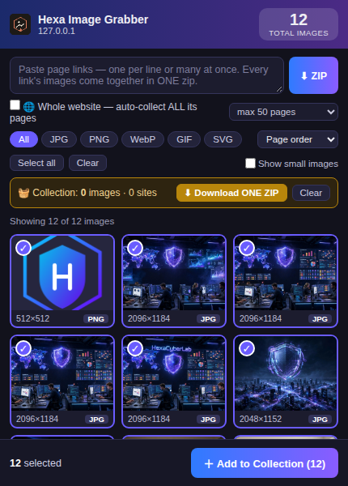
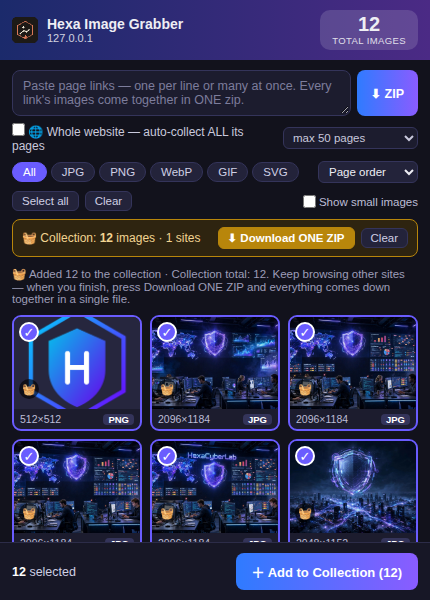
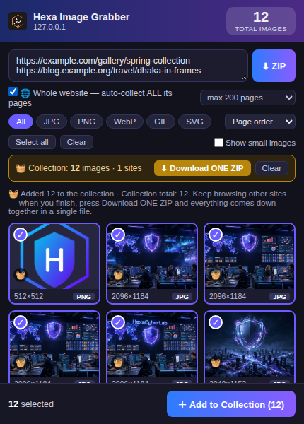
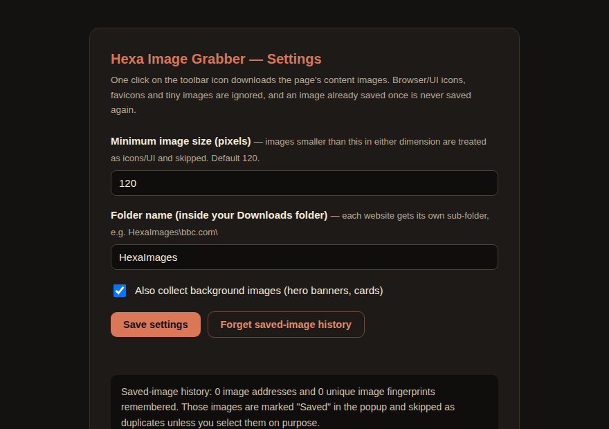

# Hexa Image Grabber

**Grab every content image from the pages you browse — or paste links, or a whole website — and get everything in ONE clean ZIP.**

A Manifest V3 browser extension for Chrome, Edge and Brave. No tracking, no servers, no sign-up: everything happens locally in your browser.

## What it does

- **Page gallery** — Click the toolbar icon on any page and instantly see *every* content image in a visual gallery: live total count, real dimensions, and a format chip (JPG / PNG / WebP / GIF / SVG) on each image. Favicons, UI icons, sprites and tiny images are filtered out automatically.
- **Pick & collect** — Click images to select them (or Select all), then **＋ Add to Collection**. Browse as many websites as you like — the badge keeps count — and finish with **⬇ Download ONE ZIP**: one file, one subfolder per website.
- **Paste links** — No need to open pages. Paste one link or fifty, in any messy format (prose, commas, brackets — the parser finds every URL). Every page's images are fetched and combined into a single ZIP. Direct image links work too.
- **Whole-website crawl** — Tick **🌐 Whole website**, paste just the site's home URL, and the extension crawls the site by itself (sitemap-aware, subdomains included, login/cart/checkout/admin paths skipped). Choose a page cap from 25 up to **ALL**, watch live progress (pages *and* images counted separately), and hit **⏹ Stop** any time — you still get a partial ZIP with everything collected so far.
- **No duplicates, ever** — Images are deduplicated three ways: normalized URL, SHA-256 content fingerprint, and a permanent saved-image registry. Anything you downloaded before is badged **"Saved"** and skipped automatically.
- **Fast** — Parallel fetching (6 at a time for images, 4 for pages) with per-file timeouts, so one dead link never stalls the batch.
- **Settings that matter** — Minimum image size (default 120 px), download folder name, background-image collection on/off, and a one-click reset of the saved-image history.

## Screenshots

| Collection basket across sites | Paste links + whole-site crawl | Settings |
|---|---|---|
|  |  |  |

## Install (Load unpacked)

1. Download this repository (green **Code** button → **Download ZIP**) and unzip it — or clone it.
2. Open `chrome://extensions` (Chrome), `edge://extensions` (Edge) or `brave://extensions` (Brave).
3. Turn on **Developer mode** (top-right).
4. Click **Load unpacked** and select the folder containing `manifest.json`.
5. Pin **Hexa Image Grabber** to your toolbar. Done — no account, no permissions beyond what the extension needs to fetch images and save the ZIP.

## How to use

**From a page you're viewing**
1. Click the extension icon → the gallery opens with all of the page's images.
2. Filter by type, sort by size, click to select/deselect.
3. **＋ Add to Collection**, keep browsing other sites, then **⬇ Download ONE ZIP**.

**From links**
1. Open the popup and paste your links into the text box (any format).
2. Optionally tick **🌐 Whole website** and pick a page cap.
3. Press **⬇ ZIP** and watch the progress — or **⏹ Stop** to keep a partial result.

Output lands in `Downloads/<your folder>/` as `<site>-images.zip` for one site, or `all-images.zip` when several sites are combined, with a subfolder per website inside.

## How it works

- `popup` — the gallery UI and the in-page collector (largest `srcset` candidate, CSS backgrounds, `og:`/`twitter:` images).
- `background` (service worker) — the collection basket, the saved-image registry (normalized URLs + SHA-256 fingerprints) and job coordination.
- `offscreen` document — the parallel fetch engine, the crawler (BFS + `sitemap.xml` seeds) and a dependency-free ZIP writer (STORE method). Nothing is uploaded anywhere; the ZIP is built locally and handed to `chrome.downloads`.

## Privacy

The extension runs entirely on your machine. It keeps no analytics, phones home to no server, and stores only two things locally: your settings and the registry of image URLs/fingerprints you have already saved (so it can skip duplicates). Reset that history any time from the Settings page.

## Version history

- **v4.6** — Crawl progress shows the real page cap; **⏹ Stop** button with partial-ZIP delivery; full audit fixes (one-job-at-a-time guard, honest download-error reporting, basket quota reporting).
- **v4.5** — Real-site crawl hardening: `sitemap.xml` seeding, subdomains treated as the same site, redirect-aware link resolution.
- **v4.4** — Page caps up to 5,000 or **ALL** (unlimited).
- **v4.3** — Whole-website crawl mode.
- **v4.2** — Many links at once, extracted from any pasted text.
- **v4.1** — ZIP any page by pasting its URL — no need to open it.
- **v4.0** — Cross-site collection basket → ONE combined ZIP.
- Earlier — gallery picker with per-page ZIP (v2–v3); one-click download (v1).

## License

MIT — see [LICENSE](LICENSE).

---

Built by [Md. Jony Hassain](https://github.com/jonyhossan110) · [HexaCyberLab](https://hexacyberlab.great-site.net/)
